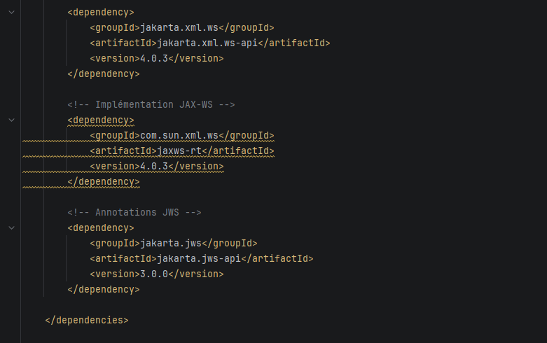
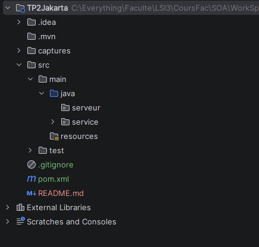
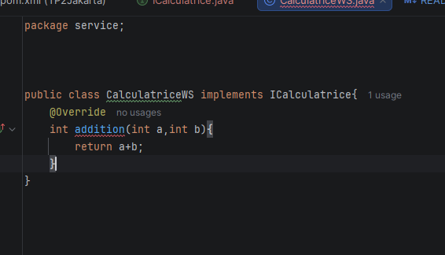
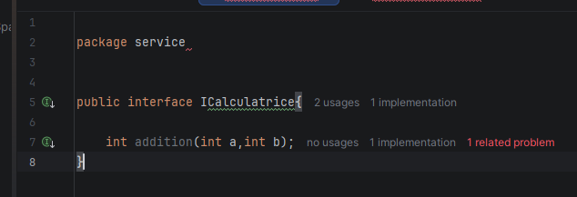
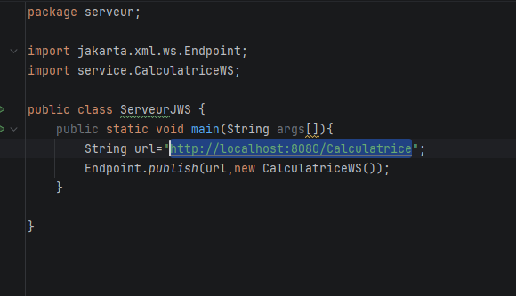
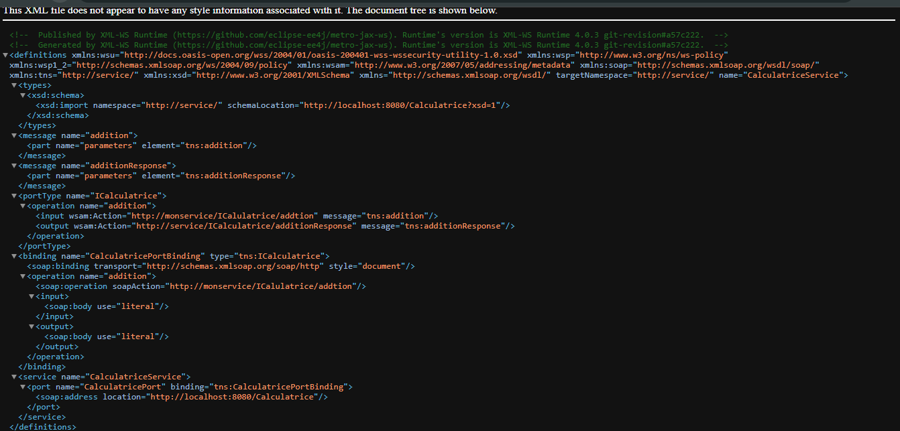
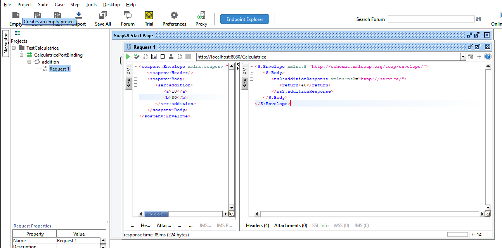

# TP2 : Mise en œuvre de Jakarta XML Web Services

**Nom :** Masmoudi
**Prénom :** Ahmed

## Activité 1 : Configuration du projet Maven

Dans cette activité, nous avons créé un projet Maven dédié au développement d'un service web SOAP avec Jakarta XML Web Services (JAX-WS). Nous avons configuré le fichier `pom.xml` en ajoutant les dépendances nécessaires : `jakarta.xml.ws-api` pour les interfaces de JAX-WS, `jaxws-rt` pour l'implémentation et l'exécution du service web, et `jakarta.jws-api` pour les annotations. Enfin, nous avons créé deux packages, `service` et `serveur`, afin d'organiser le code du projet et de séparer l'implémentation du service de son lancement.

## Activité 2 : Création de la classe métier

Nous avons créé l'interface `ICalculatrice`, qui déclare les opérations disponibles, ainsi que la classe `CalculatriceWS` qui l'implémente. Pour cette première étape, nous avons choisi d'implémenter uniquement la méthode `addition()`, qui retourne la somme de deux entiers. Les autres méthodes seront ajoutées après avoir testé le bon fonctionnement de cette première opération.

## Activité 3 : Annotations avec Jakarta XML Web Services

Nous avons utilisé les annotations de Jakarta XML Web Services pour exposer notre calculatrice comme un service web SOAP. Nous avons annoté l'interface `ICalculatrice` et la classe `CalculatriceWS` avec `@WebService`, puis utilisé `@WebMethod` pour définir les opérations exposées et `@WebParam` pour préciser les noms des paramètres échangés avec le client. Ces annotations permettent de contrôler la représentation du service dans le document WSDL.

### Captures d'écran

**1. Interface ICalculatrice annotée :**

### Activité 4 : Publication du Service Web

Dans cette activité, nous avons créé la classe `ServeurJWS` dans le package `serveur` afin de publier notre service Web SOAP à l'aide de la méthode `Endpoint.publish()`, en spécifiant une URL d'accès au service. Après le démarrage du serveur, nous avons consulté le document WSDL à travers cette URL en ajoutant `?wsdl`. Cela nous a permis de comprendre la correspondance entre la classe métier `CalculatriceWS`, l'interface `ICalculatrice` qui définit le contrat, et les différents éléments du WSDL (`service`, `port`, `portType` et `operation`). Nous avons également examiné le XSD généré, qui décrit la structure des données XML échangées, notamment les paramètres et le résultat de l'opération `addition`.

### Activité 5 : Test avec SOAPUI

Nous avons créé un nouveau projet dans SOAPUI et importé le WSDL de notre service Web. Ensuite, nous avons généré une requête pour l'opération `addition`, en renseignant les deux paramètres. Enfin, nous avons exécuté la requête et vérifié que le résultat retourné était correct.
